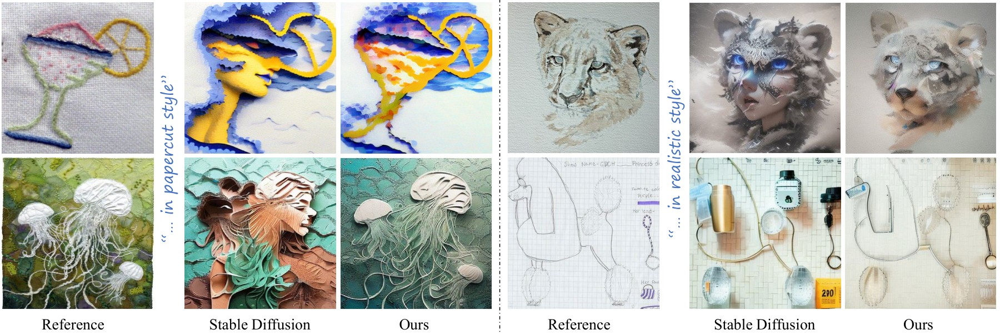
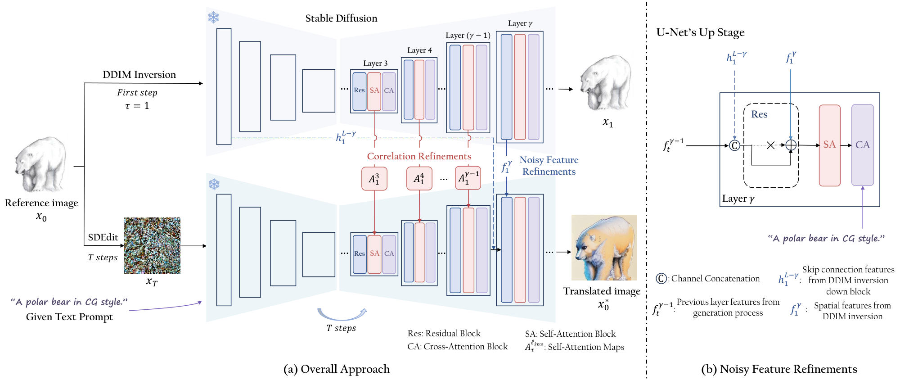
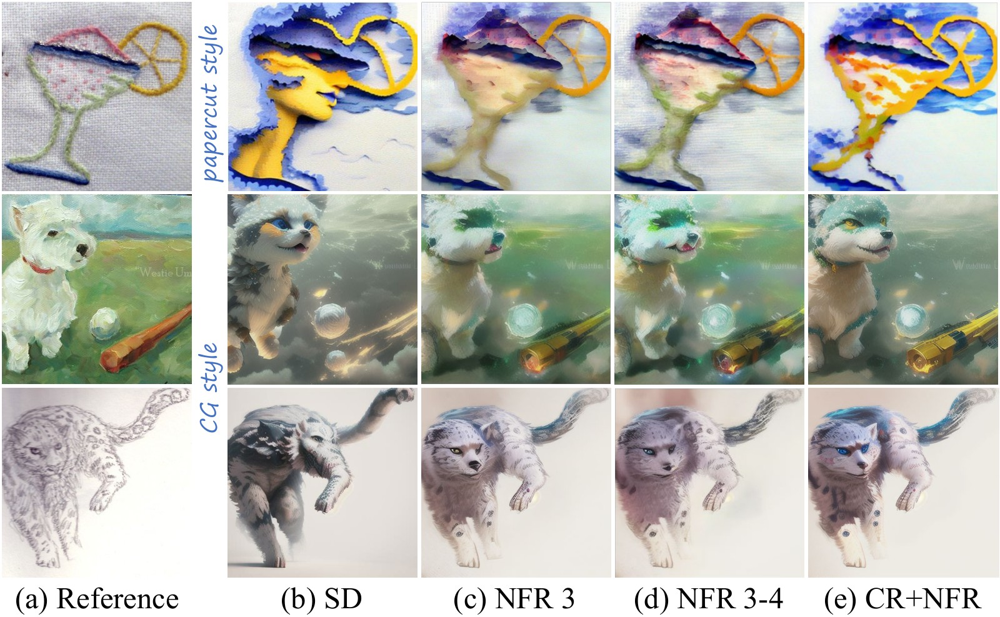
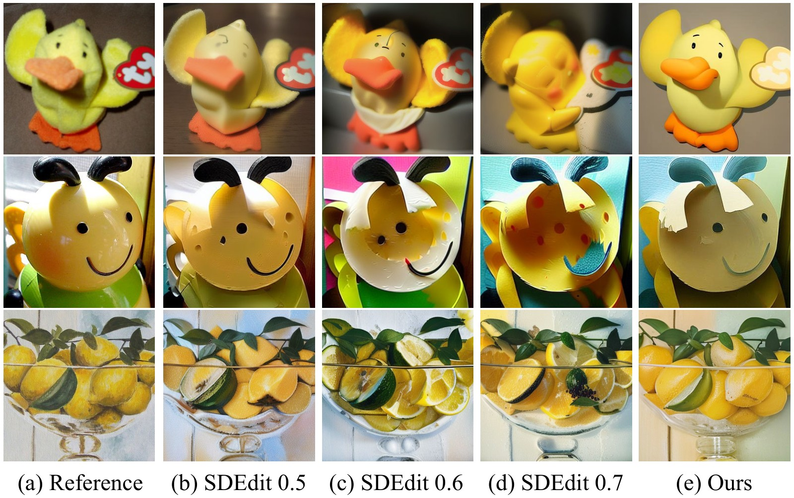
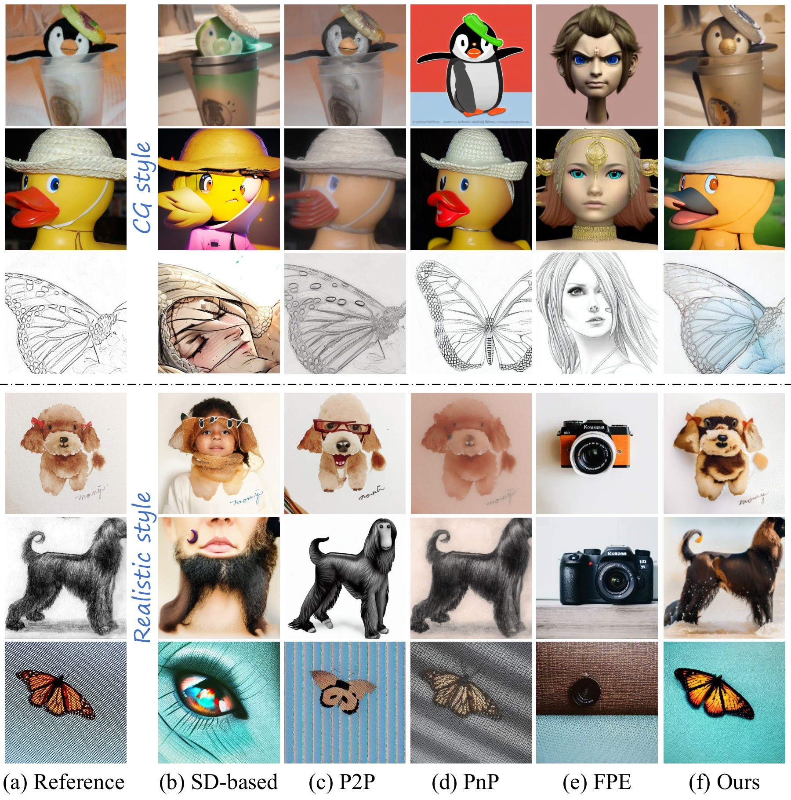

<div align="center">

# Dissecting and Mitigating Semantic Discrepancy in Stable Diffusion for Image-to-Image Translation

[**Yifan Yuan**](https://yifanyuan.com)<sup>1</sup> · **Guanqun Yang**<sup>2</sup> · **James Z. Wang**<sup>3</sup> · **Hui Zhang**<sup>4</sup> · **Hongming Shan**<sup>1</sup> · **Feiyue Wang**<sup>5&dagger;</sup> · **Junping Zhang**<sup>1</sup>

<sup>1</sup>Fudan University &emsp; <sup>2</sup>NetEase Fuxi &emsp; <sup>3</sup>The Pennsylvania State University &emsp; <sup>4</sup>Beijing Jiaotong University &emsp; <sup>5</sup>Institute of Automation, CAS
<br>
<sup>&dagger;</sup>Corresponding author

**IEEE/CAA Journal of Automatica Sinica, 2025**

<a href="https://doi.org/10.1109/JAS.2024.124800"></a>
<a href="https://yifanyuan.com/lab/projects/semantic-discrepancy/"></a>
<a href="https://github.com/huggingface/diffusers"></a>
<a href="LICENSE"></a>

</div>

<p align="center"></p>

**TL;DR:** SDEdit-style image-to-image translation with Stable Diffusion often *hallucinates content that is not in the reference image* (a cocktail glass becomes a face, a sketch of a lamp becomes a bottle...). We trace this **semantic discrepancy** to the noise added by SDEdit, which makes unrelated regions correlated after the U-Net up-sampling layers. We fix it **without any training**: the correct correlations and features are taken from a **single step of DDIM inversion** and plugged into the generation. The method is plug-and-play for any SD-1.x checkpoint and ControlNet, and **11.2× faster than PnP**.

## 🔍 Method

<p align="center"></p>

Given a reference image $x_0$, we run **one step** of DDIM inversion ($x_0 \rightarrow x_1$, $\tau = 1$, empty prompt) and keep the features of the U-Net decoder. During the usual SDEdit sampling (noise added to $x_0$, then $T$ DDIM steps with the target prompt), two refinements replace the erroneous features at every step:

| | What is replaced | Where | Effect |
|:-|:-|:-|:-|
| **CR** — Correlation Refinements | self-attention maps $A^{\ell}_t \leftarrow A^{\ell}_{\tau}$ | decoder layers 3 … $\gamma{-}1$ | removes the wrong correlations between unrelated regions |
| **NFR** — Noisy Feature Refinements | skip connection $h^{L-\gamma}$ and residual-block output $f^{\gamma}$ | decoder layer $\gamma$ | gives the next self-attention noise-free features (softer than CR, avoids the "whitening" of over-constrained attention) |

By default, CR is applied to decoder layers **3–5** and NFR to the **6th** decoder layer (index 5), as in the paper. Only one extra U-Net pass is needed, and the features are kept in memory.

<details>
<summary><b>Why both CR and NFR? (click to expand)</b></summary>
<p align="center"></p>

NFR alone keeps too much of the reference appearance (appearance leakage), while CR alone over-constrains the attention and washes out colours when applied to many layers; combining them gives faithful *and* well-translated results.
</details>

<details>
<summary><b>Algorithm (click to expand)</b></summary>

```text
Input: reference image I, target prompt P, inversion step tau = 1, CR layers, NFR layer gamma
A_inv, f_inv, h_inv <- U-Net(x0 = E(I), t = tau, prompt = "")           # single-step DDIM inversion
x_T <- SDEdit(x0)                                                    # x_T = sqrt(a_T) x0 + sqrt(1 - a_T) eps
for t = T ... 1:
    eps <- U-Net(x_t, t, P) with  A_t^l <- A_inv^l  for l in CR layers   # CR
                                  (f_t^gamma, h_t^{L-gamma}) <- (f_inv^gamma, h_inv^{L-gamma})   # NFR
    x_{t-1} <- DDIM-step(x_t, eps)
Output: I* = D(x_0)
```
</details>

## 🛠️ Installation

```bash
git clone https://github.com/Sherlockyyf/Semantic_Discrepancy.git
cd Semantic_Discrepancy
conda create -n semdis python=3.10 -y && conda activate semdis
pip install torch torchvision --index-url https://download.pytorch.org/whl/cu121   # pick the build for your CUDA
pip install -r requirements.txt
```

Models are downloaded automatically from the 🤗 Hub on first use:
[Stable Diffusion v1.5](https://huggingface.co/stable-diffusion-v1-5/stable-diffusion-v1-5) and
[ControlNet (Canny)](https://huggingface.co/lllyasviel/sd-controlnet-canny). Any SD-1.x checkpoint works, including single-file
`.safetensors` / `.ckpt` models from Civitai (e.g. [Realistic Vision](https://civitai.com/models/4201), [RevAnimated](https://civitai.com/models/7371), [PaperCut](https://civitai.com/models/40/papercut)).

## 🚀 Quick Start

**Command line** — writes `*_ours.png`, and with `--compare` also the SDEdit baseline and a side-by-side figure:

```bash
python scripts/translate.py --input path/to/image.jpg --style realistic --strength 0.5 --compare
python scripts/translate.py --input path/to/folder --output outputs/papercut --style papercut \
    --base_model path/to/papercut_v1.safetensors
```

**Python API**

```python
from semantic_discrepancy import SemanticDiscrepancyPipeline, RefinementConfig

pipe = SemanticDiscrepancyPipeline.from_pretrained(
    'stable-diffusion-v1-5/stable-diffusion-v1-5',      # or a local .safetensors file
    controlnet='lllyasviel/sd-controlnet-canny',          # None to disable ControlNet
    refinement=RefinementConfig(cr_layers=(3, 4, 5), nfr_layers=(5,)))

out = pipe('photo.jpg', prompt='realistic photo, RAW photo, 8k uhd, high quality', negative_prompt='cartoon, drawing',
           strength=0.5, num_inference_steps=20, seed=0, return_baseline=True)
out['ours'][0].save('ours.png'); out['sdedit'][0].save('sdedit.png')
```

The refinements are a thin wrapper around a diffusers `UNet2DConditionModel`, so they can be dropped into your own sampling loop:

```python
from semantic_discrepancy import SemanticDiscrepancyRefiner

refiner = SemanticDiscrepancyRefiner(unet, RefinementConfig())
with refiner.recording():                       # single-step DDIM inversion of the reference latent
    unet(x0, torch.tensor([1]), encoder_hidden_states=empty_prompt_embeds)
for t in timesteps:                             # any SDEdit / img2img loop
    with refiner.injecting(t):
        noise_pred = unet(latent_model_input, t, encoder_hidden_states=prompt_embeds).sample
```

**Gradio demo**

```bash
python app.py            # http://127.0.0.1:7860, add --share for a public link
```

## 📊 Reproducing the Paper

**Data.** We use [COCO](https://cocodataset.org) (train2017), [ImageNet](https://www.image-net.org) and [ImageNet-R](https://github.com/hendrycks/imagenet-r). Images are resized so that the shorter side is 512 px and center-cropped to 512×512 (the default of `translate.py`).

**Translation.** Stable Diffusion v1.5 + ControlNet (Canny), 20 DDIM steps, guidance 7.5, noise strength 0.5. Prompts only contain style / quality words (`configs/styles.yaml`), never a description of the image content:

```bash
python scripts/translate.py --input data/coco/train2017 --output outputs/coco     --style cartoon   --compare
python scripts/translate.py --input data/imagenet       --output outputs/imagenet --style cartoon   --compare
python scripts/translate.py --input data/imagenet-r     --output outputs/imagenet-r --style realistic --compare
```

**Evaluation.** CLIP-I (CLIP ViT-L/14 image similarity), CLIP-T (similarity between the translation and the BLIP caption of the reference) and SSIM-S (structural similarity):

```bash
python scripts/evaluate.py --results outputs/coco       --style_prefix "cartoon style of "
python scripts/evaluate.py --results outputs/imagenet-r --style_prefix "realistic style of "
```

<details open>
<summary><b>Quantitative results (from the paper)</b></summary>

| Dataset | Method | CLIP-I ↑ | SSIM-S ↑ | CLIP-T ↑ |
|:-|:-|:-:|:-:|:-:|
| ImageNet-R | SD (SDEdit) | 0.683 | 0.503 | 0.204 |
| | P2P | 0.697 | 0.581 | 0.242 |
| | PnP | 0.839 | 0.609 | 0.275 |
| | CR | 0.712 | 0.516 | 0.215 |
| | NFR | 0.752 | 0.518 | 0.231 |
| | **CR + NFR (ours)** | **0.890** | **0.635** | **0.277** |
| ImageNet | SD (SDEdit) | 0.609 | 0.356 | 0.178 |
| | P2P | 0.733 | 0.503 | 0.223 |
| | PnP | 0.844 | 0.508 | 0.229 |
| | **CR + NFR (ours)** | **0.860** | **0.572** | **0.238** |
| COCO | P2P | 0.675 | 0.474 | 0.220 |
| | PnP | 0.788 | **0.674** | 0.207 |
| | **CR + NFR (ours)** | **0.898** | 0.603 | **0.241** |

Time per image on an A100 (DDIM inversion + generation): SD 6.0 s · P2P 40.7 s · PnP 191.6 s · **ours 17.1 s** (numbers of the original implementation, which stored the inversion features on disk; this refactored version keeps them in memory).
</details>

<p align="center"><br><em>Comparison with SDEdit. Prompts from top to bottom: "CG style", "papercut style", "realistic style".</em></p>

<details>
<summary><b>Comparison with P2P and PnP (click to expand)</b></summary>
<p align="center"></p>
</details>

## 🔬 Analysis Tools

`scripts/visualize_attention.py` reproduces the analysis of Sec. IV: the self-attention maps of a decoder layer are projected to RGB with PCA for the single-step DDIM inversion, SDEdit and our method. Regions with the same colour attend to each other, so wrongly correlated regions become visible.

```bash
python scripts/visualize_attention.py --input path/to/image.jpg --style realistic --layer 8 --show_steps 0 5 9
```

## ⚙️ Options

| Argument | Default | Description |
|:-|:-|:-|
| `--strength` | `0.5` | SDEdit noise strength $t_0$. Higher = stronger translation, lower = more faithful (0.5–0.7 works well). |
| `--cr_layers` | `3 4 5` | Decoder layers whose self-attention maps are replaced (layers 3–11 have self-attention in SD-1.x). Deeper layers constrain more and may wash out colours. |
| `--nfr_layers` | `5` | Decoder layers whose residual / skip features are replaced. NFR alone keeps too much of the reference appearance; combine it with CR. |
| `--nfr_min_timestep` | `0` | Apply NFR only while `t > nfr_min_timestep`. |
| `--controlnet` | `lllyasviel/sd-controlnet-canny` | Canny ControlNet for SD-1.5 (thresholds via `--canny 50 100`), or `none`. |
| `--base_model` | SD v1.5 | diffusers repo / folder, or a single `.safetensors` / `.ckpt` file. |
| `--steps`, `--guidance_scale`, `--seed` | `20`, `7.5`, `0` | DDIM sampling settings; SDEdit and ours share the same noise. |

**Limitations.** The inversion features preserve the shape and layout of the reference, so edits that must change the shape substantially (e.g. a tiger into a bird) are out of scope.

## 📁 Repository Structure

```text
semantic_discrepancy/
├── refinement.py        # CR / NFR: attention processors + forward hooks on a diffusers U-Net
├── pipeline.py          # SDEdit + single-step DDIM inversion, ControlNet, any SD-1.x checkpoint
├── metrics.py           # CLIP-I / CLIP-T / SSIM-S
└── utils.py
scripts/
├── translate.py         # single image or dataset translation (+ SDEdit baseline)
├── evaluate.py          # quantitative evaluation
└── visualize_attention.py
configs/styles.yaml      # prompt presets used in the paper
app.py                   # Gradio demo
tests/                   # CPU unit tests with tiny random models: pytest tests
```

## 📝 Citation

If you find this work useful, please consider citing:

```bibtex
@article{yuan2025semantic,
  title   = {Dissecting and Mitigating Semantic Discrepancy in Stable Diffusion for Image-to-Image Translation},
  author  = {Yuan, Yifan and Yang, Guanqun and Wang, James Z. and Zhang, Hui and Shan, Hongming and Wang, Feiyue and Zhang, Junping},
  journal = {IEEE/CAA Journal of Automatica Sinica},
  volume  = {12},
  number  = {4},
  pages   = {705--718},
  year    = {2025},
  doi     = {10.1109/JAS.2024.124800}
}
```

## 📄 License

The code is released under the [MIT License](LICENSE). The pretrained models (Stable Diffusion, ControlNet, CLIP, BLIP) are subject to their own licenses.
